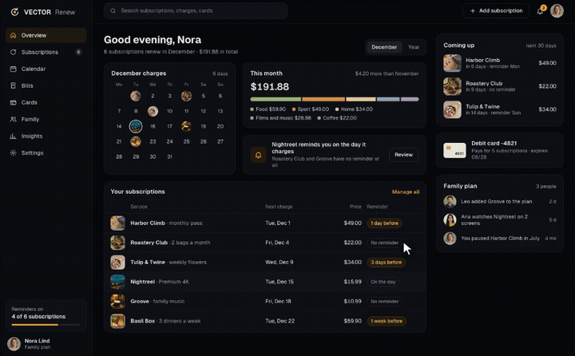

# Remind Early

**I always found out about the $15.99 on the day it charged. Now I hear about it 3 days before.**



**Live demo:** [veraetogrex-portfolio.github.io/sub-remind](https://veraetogrex-portfolio.github.io/sub-remind/) · **Mockup:** [full-screen version](https://veraetogrex-portfolio.github.io/sub-remind/mockup/sub-remind.html)

A subscription reminder screen: pick 3 days before and the bell moves off the charge day to Sat 12, the $15.99 stays on Tue 15, Save shows the push you will get. Vanilla HTML/CSS/JS, zero dependencies.

## Try it

- Click the Nightreel row in Your subscriptions. The subscription opens: on the December 6–19 strip the amber bell sits on Tue 15, right above the $15.99 charge tag, and Remind me is set to On the day.
- Pick 3 days before. The bell lifts off the charge day and slides to Sat 12 in 0.74 s, a bracket trails it back to the tag and reads "3 days to decide". The tag stays on the 15th, Sat 12 lights up, the summary shows "Sat, Dec 12 · 9:00 AM". 1 day before and 1 week before move the bell to Mon 14 and Tue 8. Switch mid-move — the last choice wins.
- Press Save reminder. The button turns into "Reminder saved" and the summary gives way to the push you will get: "Nightreel renews in 3 days · $15.99 on Tue, Dec 15". Pick another option and Save is active again; go back to the saved one and the push returns.
- Go back to Subscriptions: the Nightreel row now says "3 days before".
- Keyboard: Tab to the Remind me group, arrow keys move the bell; Enter saves, Space flips the switches.
- With reduced motion on, the bell, the bracket and the push change at once.

## Use it

Three files and the photos, no build step, no dependencies:

```
index.html   markup
style.css    styles
script.js    logic
assets/      the photos (generated, free to reuse with the code)
```

Download the repo and open `index.html`, or copy the files into your project. Set `data-assets` on `<section class="sr">` to the folder with your photos. The root element exposes `renewApp` with `reset()`, `go('overview' | 'sub')`, `setLead(0 | 1 | 3 | 7)` and `save()`.

## License

MIT
